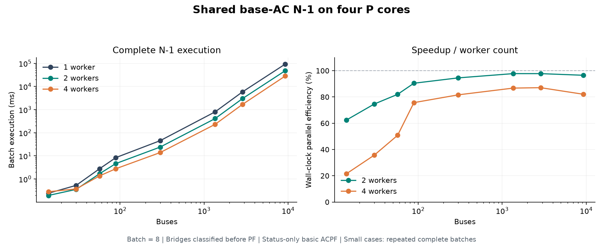

# 共享基态 AC 初始化的 N−1 规模趋势

Rust 高层封装完成后，使用 `N1Study::run` 的当前数值路径，在同一台 Lunar Lake 上按规模测量。所有案例的 1／2／4 worker 场景判定一致。



## 方法

- CPU 固定 0–3，均为 P 核；每个 worker 数单独启动进程，测量串行进行。
- 每个案例先以 DCPF＋AC 求得收敛基态，所有退出场景共享其 AC 电压初值。PQ/PV/Slack 分区固定。
- 所有在役线路和两绕组变压器分别形成独立 N−1；Tarjan 分类无 Slack 解列，其余进入 PF。
- batch=8，StatusOnly，max_iter=30，tolerance=1e-10。统一使用空约束规则表，衡量基础 ACPF 收敛与解列状态；原设备参数、限值保留。完整安全约束筛选的 9241 结果见 N1_USAGE.md。
- 每次整批执行都会创建 worker App／私有数值工作区和 collector，完成后 join。小案例重复整批，表中为执行中位数；每个配置的原始样本、最小值、最大值均保存。
- 整批计时从进入 study.run 到返回，包含实体解析、解列分类、任务发射、线程创建、数值求解、配置的检查、收集与退出。准备时间单独计；首次调用总成本从 CSV 加载前算到首批返回。
- 加速比 S(P)=T(1)/T(P)，并行效率 E(P)=S(P)/P；采用实际墙钟，包含核频和共享硬件资源的影响。

## 整批执行结果

| 母线 | 全部场景 / 数值求解 | 重复 | 1 worker ms | 2 worker ms | 4 worker ms | 2 worker 加速 / 效率 | 4 worker 加速 / 效率 |
| ---: | ---: | ---: | ---: | ---: | ---: | ---: | ---: |
| 14 | 20 / 19 | 201 | 0.242 | 0.194 | 0.281 | 1.249× / 62.4% | 0.862× / 21.5% |
| 30 | 41 / 38 | 101 | 0.530 | 0.355 | 0.371 | 1.492× / 74.6% | 1.427× / 35.7% |
| 57 | 80 / 79 | 101 | 2.776 | 1.693 | 1.365 | 1.640× / 82.0% | 2.034× / 50.8% |
| 89 | 210 / 194 | 51 | 8.413 | 4.651 | 2.779 | 1.809× / 90.4% | 3.027× / 75.7% |
| 300 | 411 / 322 | 21 | 45.371 | 24.001 | 13.899 | 1.890× / 94.5% | 3.264× / 81.6% |
| 1354 | 1991 / 1430 | 3 | 800.974 | 409.649 | 230.846 | 1.955× / 97.8% | 3.470× / 86.7% |
| 2869 | 4582 / 3804 | 3 | 5866.724 | 3000.912 | 1684.674 | 1.955× / 97.7% | 3.482× / 87.1% |
| 9241 | 16049 / 14384 | 1 | 92753.212 | 48054.057 | 28259.399 | 1.930× / 96.5% | 3.282× / 82.1% |

## 一次性准备与首次调用总成本

以下均为实际测量，单位 ms。准备包含共享 AC/DC 分析与基态 DCPF＋AC；Study 包含基态验证和故障集合构建。首次总成本包含加载、准备和第一批，独立于上表的重复中位数。

| 母线 | 加载＋World 初始化（P1） | 共享准备（P1） | Study（P1） | 首次总成本 P1 | 首次总成本 P2 | 首次总成本 P4 |
| ---: | ---: | ---: | ---: | ---: | ---: | ---: |
| 14 | 1.140 | 0.069 | 0.002 | 1.819 | 1.665 | 1.922 |
| 30 | 1.157 | 0.092 | 0.002 | 2.082 | 1.984 | 2.456 |
| 57 | 1.456 | 0.179 | 0.003 | 4.627 | 3.559 | 3.029 |
| 89 | 1.819 | 0.286 | 0.004 | 11.266 | 6.970 | 5.658 |
| 300 | 2.944 | 0.710 | 0.006 | 50.449 | 28.087 | 17.863 |
| 1354 | 10.378 | 2.921 | 0.022 | 814.296 | 424.053 | 244.530 |
| 2869 | 20.612 | 7.461 | 0.060 | 5889.254 | 3037.170 | 1713.146 |
| 9241 | 69.441 | 29.481 | 0.201 | 92852.337 | 48153.977 | 28362.424 |

## 解释与一致性

- 14 母线仅有 19 个实际数值场景，batch=8 产生三个任务组；四 worker 的可用组数和线程启动成本共同限制收益。
- 30／57 母线开始获得并行收益；89／300 的计算量足以摊薄调度成本。1354／2869 的四 worker 效率约 87%，9241 约 82%。
- 每个 worker 内连续执行 patch、PF 和配置规则检查；collector 负责接收。当前共享队列继续承担动态领批。
- 每次重复均在进程内校验场景状态一致；汇总脚本再按退出索引比较 1／2／4 worker 的失败状态、解列集合及总计数。24 个配置均通过。

| 母线 | 解列 | 收敛 | 数值失败 |
| ---: | ---: | ---: | ---: |
| 14 | 1 | 19 | 0 |
| 30 | 3 | 38 | 0 |
| 57 | 1 | 73 | 6 |
| 89 | 16 | 194 | 0 |
| 300 | 89 | 306 | 16 |
| 1354 | 561 | 1428 | 2 |
| 2869 | 778 | 3804 | 0 |
| 9241 | 1665 | 14374 | 10 |

## 最小案例 batch=1 补充对照

主表继续使用统一 batch=8。另对同一个 14 母线输入测 batch=1，1／2／4 worker 各重复整批 201 次；CPU、初值、容差、规则及场景分类相同。两种 batch 的逐场景状态一致。

| batch | 数值任务组 | 1 worker ms | 2 worker ms | 4 worker ms | 4 worker 加速 / 效率 |
| ---: | ---: | ---: | ---: | ---: | ---: |
| 8 | 3 | 0.242 | 0.194 | 0.281 | 0.862× / 21.5% |
| 1 | 19 | 0.296 | 0.216 | 0.312 | 0.947× / 23.7% |

batch=1 已提供 19 个任务组，四 worker 的收益仍很小。此对照支持：微型案例中，线程／App／数值工作区创建、同步与回收等固定成本占比较大，任务组数量解释了部分限制。具体启动与同步分项在此未单独计时。

| batch=1 的 worker 数 | 共享准备 ms | Study ms | 首次调用到返回 ms |
| ---: | ---: | ---: | ---: |
| 1 | 0.065 | 0.001 | 1.724 |
| 2 | 0.063 | 0.001 | 1.797 |
| 4 | 0.067 | 0.001 | 1.806 |

计时起止与主表相同：共享准备从 prepare_n1 调用前到返回；执行从 study.run 前到返回；首次总成本从 CSV 加载前到第一批返回。记录见 minimal-batch1-comparison.json。主表对应的原测量二进制已保存为 bench_n1_scale.measured，补充测试的二进制哈希单独记录。

```sh
python /home/cts/Documents/Codex/2026-10-26/task/run_n1_minimal_batch.py
```

## 环境与复现

- Intel Core Ultra 7 288V，四个 P 核绑定 0–3。intel_pstate=active，四个 P 核 governor=powersave、EPP=performance，Turbo 开启，perf 范围 8–100%。
- power-profiles-daemon 的 D-Bus 查询在当前权限下不可用；原始错误及可读 sysfs 电源配置、各轮前后瞬时频率均保存在 metadata.json / process.json。测试保持这些配置。
- 小中案例取自本机已安装 pandapower 3.5.4 的内置案例；9241 使用仓库现有 ZIP。CSV 导出保留索引，整数列按 Rust 格式序列化，Ratio tap 的旧字段 tap_phase_shifter=false；输入 ZIP SHA256 已保存。118 按既有约定排除。
- 原始数据目录：`/home/cts/Documents/Codex/2026-10-26/task/n1-scalability/`，包含 24 份 result.json、process.json、日志、全部样本、summary.json/CSV、二进制哈希和输入清单。

```sh
CARGO_TARGET_DIR=/home/cts/workspace/rustpower-amd-supervariable/target cargo build --offline --release --features experimental_n1 --example bench_n1_scale
taskset -c 0-3 /home/cts/workspace/rustpower-amd-supervariable/target/release/examples/bench_n1_scale case14 /home/cts/Documents/Codex/2026-10-26/task/n1-scalability/cases/case14.zip 4 201 /tmp/n1-scale-case14.json
python /home/cts/Documents/Codex/2026-10-26/task/run_n1_scale.py
```
