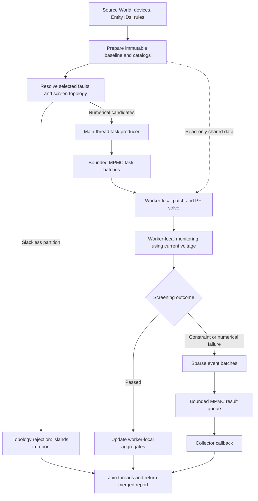
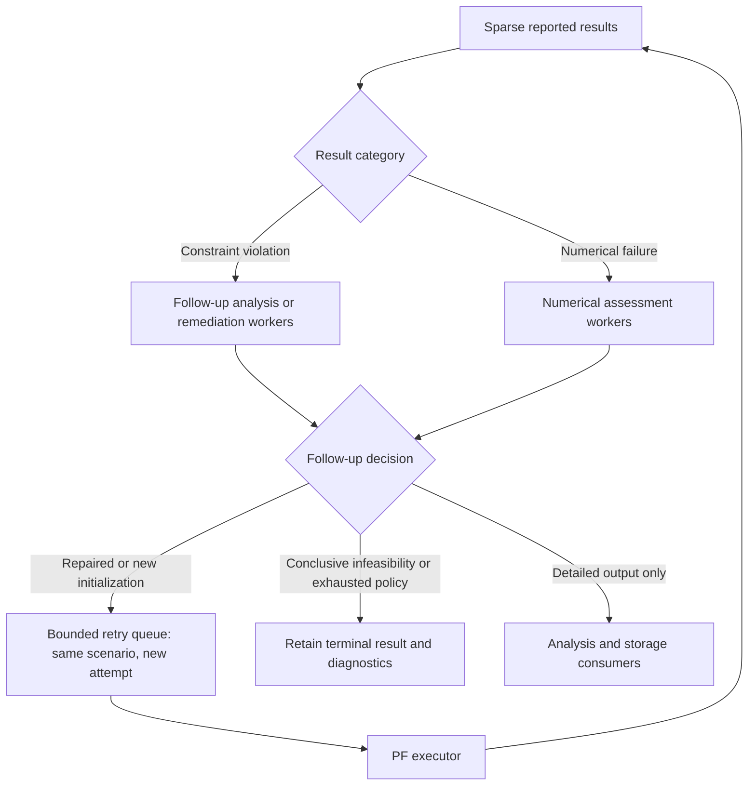
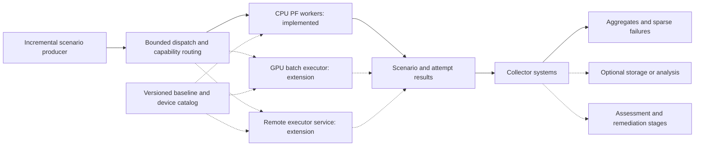

# Contingency execution as bounded dataflow

RustPower's contingency design starts from two observations: an individual power
flow can be quick, while the number of scenarios and the amount of retained data
can be enormous. The default screening workload primarily needs to identify failures.
The architecture therefore separates task production, numerical execution, and result
consumption, with explicit control over in-flight work and retained output.

The current CPU N−1 implementation is the first executor for this design.
[The usage guide](../N1_USAGE.md) describes the available Rust and Python interfaces.

## Roles and the current execution path

The main World owns the source model, device identities, and monitoring configuration.
Preparation creates a frozen numerical snapshot and shared branch/rule tables.
The producer compiles compact outage tasks; workers own mutable numerical state;
the collector consumes reported results. Each stage has a distinct data lifetime.



In the implemented CPU runner, the caller produces tasks, P scoped worker threads
each own a small App, and one collector runs the callback. An App message activates
a received group. Workers continuously take batches from the shared queue, giving
available workers access to the next batch as scenario costs vary.

Both queues hold up to 2P batches. Numerical buffers and KLU Numeric/Common objects
belong to individual workers. The sparsity patterns, analyses, base voltage, branch
SoA, and rule plan are shared read-only within the process. The source World stays
at the baseline throughout the study.

## Memory is governed by the in-flight window

N−2 makes the motivation concrete: 16049 devices have 128777176 unordered pairs.
Materializing every pair as a complete scenario, matrix, or result would make the
scenario count determine the memory footprint before useful work even starts.
The intended N−k producer instead enumerates compact descriptors incrementally.
Queue capacity and batch size limit how far generation runs ahead of execution.

The target working-memory model is:

```text
shared snapshot
+ workers × private numerical workspace
+ queued/active task blocks
+ bounded result and assessment windows
+ explicitly retained consumer data
```

A full task-cache option can be useful for small studies and repeated runs. A bounded
streaming option is the natural choice for large combinations. Worker count, task
batch size, queue capacity, optional recycling, and downstream retention are separate
controls. They serve different latency, throughput, and memory objectives.

Today, the bounded queues already limit in-flight batches. The Rust high-level
`N1Study` also materializes its fault selection, numerical candidate indices, and
island records. A generalized large N−k interface must stream those stages too.
The low-level N−1 runner already accepts an iterator of branch indices; its numerical
task representation currently describes a single branch outage.

`max_batch_bytes` is an estimate for one group's task/event/detail scratch.
The total process budget also includes LU storage, allocator retention, thread stacks,
source data, and consumer-held results. KLU storage can change with numerical pivoting
and full-factor recovery. These are independent terms in a complete memory budget.

### Optional task storage recycling

The design allows a worker to return an emptied task block to a reusable pool, or
to release it after consumption. This policy concerns descriptor storage. Each worker
already reuses its numerical workspace and restores the previous scenario's touched
matrix slots from the shared baseline before applying the next task.

Task-block recycling is a planned optimization. Current task Vecs are allocated per
batch and released after consumption; result batches transfer ownership to consumers.
A recycled block becomes reusable after its consumer releases ownership. Payloads
retained for analysis have their own lifetime and budget.

## Screen topology before spending numerical work

Preparation runs Tarjan's bridge analysis once on the baseline branch multigraph.
DFS intervals and subtree Slack counts make each single-bridge outage query O(1).
Parallel circuits retain separate identities.

A selected outage that separates a partition with no configured Slack is a terminal
screening rejection for this study. The current Rust API records it in
`N1StudyReport.islands`, outside the three numerical `N1Outcome` variants, and includes
it in the report's overall rejected count. Numerical workers receive the remaining
scenarios.

This screening is specific to the fixed-baseline N−1 path. N−2 can disconnect the
network by removing two individually non-bridge edges; a generalized implementation
needs a combination-aware topology screen. Its outage patch must also combine
contributions to shared matrix slots. These are explicit extensions to the current
single-branch descriptor.

## Keep routine screening output sparse

In default `StatusOnly` mode, a passing scenario updates local counters, iteration
sums, and timing statistics. The worker then moves on. A rejected numerical scenario
produces a status event identifying the scenario and source device. An entire group
with no events generates no result-queue message.

Workers evaluate constraints directly against their current voltage before reusing
that buffer. Threshold screening uses the first violation to decide rejection.
Detailed branch values and hit lists are produced when the selected mode needs them.
The public owned-solution API remains available for callers retaining full voltage.

| Use case | Execution and retention policy |
| --- | --- |
| Routine security screening | Aggregate passes; emit numerical/constraint rejections; return topology rejections separately |
| Inspect selected scenarios | Rerun a subset with configured detailed monitoring and selected-case statuses |
| Store or analyze successful scenarios | Explicitly request status/detail output and choose a collector retention policy |
| Process constraint violations | Forward scenario identities to a follow-up assessment or remediation stage |
| Diagnose numerical failure | Keep diagnostic status and submit a bounded numerical-assessment job |

`Detailed` rule evaluation and result emission are separate concepts in the API:
configured `Detailed` emits matching rule payloads; `study.details()` additionally
sets `emit_all=true` for every selected numerical scenario. The Python wrapper
retains reported Rust events until the call returns, and converts columns on demand.
Streaming storage is available through the Rust collector callback.

A persistent screening format can represent a completed run as a versioned scenario
catalog, aggregate counts, and sparse exceptions with an implicit `Passed` default.
Completion coverage must accompany partial runs. Delta/variable-length encoding of
exception indices and a dedicated compressed result format are future storage choices;
the current event stream already omits default passing statuses.

## Let the collector host independent result systems

Numerical workers perform the monitoring needed to classify a scenario. The collector
is a boundary for additional aggregation, storage, distribution, and follow-up jobs.
This keeps user-specific analysis out of the PF hot loop.

Task batches and result-consumer batches can have different sizes. For example,
workers may solve groups of eight while a storage consumer aggregates several
received groups into a larger write. The consumer also defines a flush condition
for a final partial batch or a latency limit.

Multiple collectors can divide a result queue between consumers. A batch that must
feed several systems is dispatched to those systems by its receiving collector.
Ownership or immutable sharing determines how long the payload remains alive.
Bounded queues propagate backpressure when analysis or remote storage falls behind.
Independent downstream batching and multiple collectors are planned; the current
runner provides one collector and the batch callback.

The ECS serves as a typed source-data table, configuration layer, and identity map.
Preparation extracts the arrays needed by numerical kernels. `outage_entity` identifies
the removed device; `WatchHit.source_entity` identifies the device or bus whose rule
matched. This allows compact result processing with later lookup of names, ratings,
and user components. Collector-side systems can reuse the same identity model.

## Constraint remediation and numerical recovery have separate paths

A converged scenario with a violated constraint can be handed to downstream workers
for detailed analysis, remedial actions, optimization, or storage. It already has a
usable numerical result and a clearly identified violated condition.

Numerical failure takes an assessment path. The current worker first attempts local
linear-solver recovery: an unusable refactor/solve triggers a full factorization and
solve retry with the preserved RHS. Remaining numerical failures are emitted with
stage, residual, iterations, error, and linear-solver diagnostics.



This diagram describes follow-up orchestration. Today, callers can extract failures,
then invoke `study.run` with `DcPerCase` or `study.details` on the same prepared data.
Each call starts its scoped worker group. The dedicated assessment pool and automatic
retry queue are future components.

In the project owner's current experiments, the remaining unrecovered cases are
treated as infeasible following independent solver checks. The runtime records
`NumericalFailure`; downstream assessment owns the final diagnosis and evidence.
Future recovery methods can return a revised task to execution. A retry preserves
scenario identity and adds an attempt identity and recovery reason.

Recovery that changes only initialization or solver policy can reuse a compatible
snapshot. Remedial changes to topology, injections, bus partition, or monitored
configuration require a matching scenario model and, where necessary, a newly
prepared analysis. The owner of the task selects the appropriate numerical context.

A cyclic retry workflow needs bounded attempt counts and explicit completion
accounting. A run can close after initial generation finishes and all registered
execution, assessment, remediation, and retry work is terminal. Each logical scenario
contributes one final outcome; attempt statistics are counted separately. This extends
the current runner's simpler producer-finished flag and join-based completion.

## Leave room for heterogeneous and remote executors

The task boundary expresses a contingency against a specific baseline. Execution
can be routed according to backend capability and preferred batch size. CPU threads,
a GPU batch executor, or a remote service can produce the same logical result classes.



Within one process, executors can borrow immutable baseline buffers. A remote
executor instead caches a baseline identified by version/hash and receives serialized
scenario descriptors. Stable device IDs and scenario IDs travel with the request;
source Entity values remain useful within their owning World namespace. Absolute
matrix offsets are valid for the exact matrix ordering and pattern version they name.
Each process/backend owns its local analysis and writable numerical state.

A GPU executor would normally receive a group of scenarios and retain its numerical
state across Newton iterations. Its batch size, memory footprint, precision, solver
backend, and failure-handling capability form part of its dispatch contract. Current
experiments defer Jacobian-only offload because factorization dominates the measured
path; evaluating a suitable batched sparse direct solver is the prerequisite.

GPU and distributed execution are architectural directions. The current transport
and implementation use in-process CPU workers, scoped lifetimes, and Crossbeam queues.
The reusable idea is the separation of scenario description, execution ownership,
result policy, and bounded admission at each stage.

## Implementation map

| Capability | Current state |
| --- | --- |
| Shared baseline and private numerical workspaces | Implemented |
| Caller-thread task production and bounded MPMC batches | Implemented |
| Fixed-baseline N−1 Slackless-island screening | Implemented |
| Sparse screening, detailed reruns, Entity traceability | Implemented |
| Worker-local full-factor fallback and selected DCPF reruns | Implemented |
| One collector callback for user-defined result processing | Implemented |
| Optional task-block recycling and Auto/Full/Budget admission policies | Planned |
| Independent consumer batching and multiple collectors | Planned |
| Dedicated assessment pools and automatic repaired-task requeue | Planned |
| Streaming N−k fault generation and combination-aware topology checks | Planned |
| GPU and network transports/executors | Planned |
